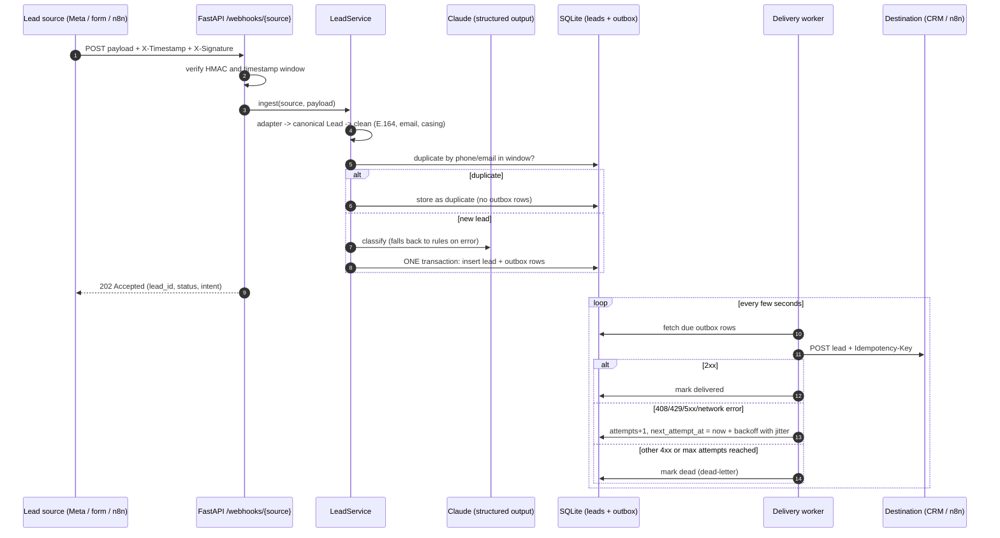

# lead-router

A small webhook service that takes in leads from ad and form sources (Meta lead ads, website
contact forms, any flat JSON), cleans them up, scores them with an LLM, and forwards them to
downstream tools like a CRM, a WhatsApp/notification webhook, or Google Sheets via n8n.
Every inbound request must carry an HMAC signature. Phone numbers are normalised to E.164 and
duplicates are caught. Claude classifies each lead as hot, warm, cold or spam using
schema-validated structured output, and a deterministic rule-based scorer takes over when
there's no API key or the call fails. Delivery uses a transactional outbox with retries,
exponential backoff and a dead-letter state, so a lead is never lost because a destination
was down for a few minutes. The project is modelled on the kind of clinic lead-automation
work I do with Python and n8n.

## Architecture



```
src/lead_router/
  main.py           FastAPI app factory, endpoints, worker lifecycle
  service.py        ingest pipeline: adapt -> clean -> dedupe -> score -> store
  adapters.py       Meta / website / generic payloads -> canonical Lead
  cleaning.py       whitespace, name casing, E.164 phones, email validation
  security.py       HMAC-SHA256 signing and verification with timestamp tolerance
  scoring.py        rule-based scorer + scorer factory
  llm.py            Claude classifier via structured outputs, with fallback
  db.py             SQLite repository: leads, outbox, metrics
  delivery.py       outbox worker: httpx, backoff + jitter, dead-letter
  models.py         pydantic models (Lead, Classification, OutboxItem, ...)
  config.py         pydantic-settings configuration
  logging_setup.py  JSON log formatter
```

## Quickstart

Requires Python 3.12+. Commands are for bash (Linux, macOS, Git Bash). Windows PowerShell
differences are in the comments.

```bash
python -m venv .venv
source .venv/bin/activate          # PowerShell: .venv\Scripts\Activate.ps1
pip install -e ".[dev]"
cp .env.example .env               # PowerShell: copy .env.example .env
```

Run three terminals (activate the venv in each one):

```bash
# 1) A fake CRM webhook. It answers 503 to the first request so you can watch a retry.
python scripts/mock_destination.py --port 9000 --fail-first 1

# 2) The service (reads .env from the current directory)
uvicorn lead_router.main:create_app --factory --port 8000

# 3) Send signed sample leads
python scripts/send_sample.py meta        # hot dental lead
python scripts/send_sample.py website     # cold hair lead ("just exploring")
python scripts/send_sample.py generic     # warm skin lead
python scripts/send_sample.py generic --file samples/spam_lead.json   # spam, stored only
python scripts/send_sample.py meta        # same person again -> duplicate
```

Then look at the results:

```bash
curl "http://localhost:8000/leads"
curl "http://localhost:8000/leads?intent=hot"
curl "http://localhost:8000/leads/<lead_id>"          # includes delivery attempts
curl -X POST "http://localhost:8000/leads/<lead_id>/redeliver"
curl "http://localhost:8000/metrics"
curl "http://localhost:8000/webhooks/meta?hub.mode=subscribe&hub.verify_token=dev-verify-token&hub.challenge=42"
```

Interactive API docs are at http://localhost:8000/docs. Without `ANTHROPIC_API_KEY` the app
uses the rule-based scorer (`/health` shows which scorer is active). To use Claude, set the
key in `.env` and restart.

### Docker

```bash
cp .env.example .env
docker compose up --build                  # just the service
docker compose --profile n8n up --build    # plus n8n on http://localhost:5678
```

When running with n8n, import `n8n/lead-router-workflow.json`, fill in the placeholder
credentials, spreadsheet ID and notification URL, then set
`DESTINATIONS={"n8n": "http://n8n:5678/webhook/lead-router"}` in `.env`.

## API

| Method | Path | Purpose |
|---|---|---|
| `POST` | `/webhooks/{source}` | Ingest a signed lead (`meta`, `website`, `generic`). Returns 202. |
| `GET` | `/webhooks/meta` | Meta subscription handshake (`hub.mode`, `hub.verify_token`, `hub.challenge`). |
| `GET` | `/leads` | List leads. Filters: `status`, `intent`, `source`. Paging: `limit`, `offset`. |
| `GET` | `/leads/{id}` | One lead plus its delivery attempts. |
| `POST` | `/leads/{id}/redeliver` | Re-queue a lead's deliveries (e.g. after fixing a dead destination). |
| `GET` | `/metrics` | Counts by lead status, intent, source and outbox status. |
| `GET` | `/health` | Liveness, active scorer, destination names. |

Signature scheme: `X-Timestamp: <unix seconds>` and
`X-Signature: sha256=<hex HMAC-SHA256(secret, "<timestamp>.<raw body>")>`.

## Configuration

All settings are environment variables (or `.env`). See `.env.example`.

| Variable | Default | Description |
|---|---|---|
| `DATABASE_PATH` | `lead_router.db` | SQLite file path. |
| `WEBHOOK_SECRETS` | `{}` | JSON map of source to HMAC secret. Sources without a secret are rejected. |
| `SIGNATURE_TOLERANCE_SECONDS` | `300` | Max age (and clock skew) of a signed request. |
| `META_VERIFY_TOKEN` | unset | Token for the Meta GET verification handshake. |
| `DEFAULT_REGION` | `IN` | Region for phone numbers without a country code. |
| `DEDUPE_WINDOW_HOURS` | `24` | Same phone or email inside this window counts as a duplicate. |
| `ANTHROPIC_API_KEY` | unset | Turns on the Claude classifier. Unset means rules only. |
| `LLM_MODEL` | `claude-haiku-5-5` | Claude model used for classification. |
| `LLM_TIMEOUT_SECONDS` | `20` | Timeout for the classification call. |
| `DESTINATIONS` | `{}` | JSON map of destination name to webhook URL. |
| `OUTBOUND_SIGNING_SECRET` | unset | If set, outbound requests are signed with the same scheme. |
| `FORWARD_SPAM` | `false` | Also forward leads classified as spam. |
| `DELIVERY_MAX_ATTEMPTS` | `6` | Attempts before a delivery is dead-lettered. |
| `DELIVERY_BASE_DELAY_SECONDS` | `2` | First retry delay; doubles each attempt. |
| `DELIVERY_MAX_DELAY_SECONDS` | `300` | Cap on the retry delay. |
| `DELIVERY_TIMEOUT_SECONDS` | `10` | HTTP timeout per delivery attempt. |
| `WORKER_ENABLED` | `true` | Run the delivery worker inside the API process. |
| `WORKER_POLL_INTERVAL_SECONDS` | `2` | How often the worker checks the outbox. |
| `WORKER_BATCH_SIZE` | `20` | Max outbox rows handled per poll. |
| `LOG_LEVEL` | `INFO` | Log level for JSON logs. |

## Design decisions and trade-offs

**Why a transactional outbox?** The naive version is "save the lead, then POST it to the
CRM". If the process crashes between those steps, or the CRM is down, the lead is saved but
never delivered, and nothing records that it still needs to go out. Here the lead and one
outbox row per destination are written in a single SQLite transaction, so they exist
together or not at all. A separate worker reads the outbox and delivers. That makes delivery
*at-least-once*: a lead can be sent twice (for example, the CRM accepts it but we crash before
marking it delivered). That's why every request carries an `Idempotency-Key`
(`<lead_id>:<destination>`), which stays the same on every retry so the receiver can drop
repeats.

**Why HMAC plus a timestamp?** An HMAC proves the sender knows the shared secret and that the
body wasn't modified. On its own, though, a captured request could be replayed forever. The
timestamp is part of the signed message, so it can't be changed without breaking the
signature, and requests older than `SIGNATURE_TOLERANCE_SECONDS` are rejected. Signatures are
compared with `hmac.compare_digest` (constant time). Sources without a configured secret are
refused rather than accepted unsigned (fail closed). A replay *inside* the window is still
possible; the dedupe check stops it from creating a second deliverable lead.

**Why a fallback scorer?** The LLM is the best classifier available here, but it's an
external dependency that can time out, rate-limit, refuse, or simply not be configured.
Losing or delaying a lead because of that would be worse than a slightly less clever score.
The rule-based scorer is deterministic and free, and it's what the whole test suite runs
against, so the app works with no API key at all. It also handles obvious spam (no valid
contact details, SEO pitches) so those never cost an API call. The LLM is called through
structured outputs (`messages.parse` with a pydantic schema), so the reply is guaranteed to
match `Classification`, with no fragile JSON parsing of free text.

**Other trade-offs:**
- *SQLite and an in-process worker* keep the setup to one container. The worker assumes a
  single instance. Running several replicas would need row claiming (`SELECT ... FOR UPDATE
  SKIP LOCKED` on Postgres) or a real queue.
- *Scoring happens inside the webhook request* so the response can include the intent.
  With the LLM enabled this adds model latency to the request (bounded by
  `LLM_TIMEOUT_SECONDS`). Moving scoring into the worker would make responses faster.
- *Invalid fields are dropped, not rejected.* A lead with a typo'd email but a valid phone is
  still worth a call, so problems are recorded in `issues` instead of returning 422.
- *Meta specifics:* Meta's real leadgen webhook only sends a `leadgen_id` and signs with
  `X-Hub-Signature-256` (no timestamp). In practice an n8n flow or relay fetches the lead's
  `field_data` from the Graph API and forwards it here using this service's signature scheme.
  The `meta` adapter expects that fetched shape.

## Tests

```bash
pytest          # all tests: no network, no API key needed
ruff check .
```

The tests cover signature verification (including replay and timestamp swapping), every
adapter, phone/email/name cleaning, dedupe, the rule-based scorer, the LLM path with a mocked
client (success, API error, refusal, spam short-circuit), outbox retry/backoff/dead-letter
using `httpx.MockTransport`, the API endpoints via FastAPI's `TestClient`, and the n8n
workflow's structure. CI runs ruff and pytest on Python 3.12 and 3.13.

## Next steps

- Native Meta support: verify `X-Hub-Signature-256` and fetch lead details from the Graph API.
- Nonce cache (seen signatures within the tolerance window) to block in-window replays.
- Move LLM scoring into the worker so webhook responses don't wait on the model.
- Postgres and row-level claiming so several worker replicas can run safely.
- Per-destination payload templates (field mapping for specific CRMs).
- Prometheus metrics and a small dashboard for dead-lettered deliveries.
- An evaluation set of labelled (fictional) leads to compare the LLM and the rule scorer.

## License

MIT. See [LICENSE](LICENSE). All names, phone numbers and emails in `samples/` and the tests are
fictional.
