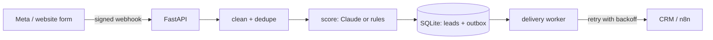

# lead-router

[](https://github.com/RutuK2005/lead-router/actions/workflows/ci.yml)

A small FastAPI service that receives leads from Meta lead ads, website forms or any flat JSON webhook, cleans them up, scores them and forwards them to a CRM or an n8n workflow.

I do a lot of clinic lead automation in n8n, and the same problems keep coming up: people submitting the same form twice, phone numbers in five different formats, junk from SEO agencies, and leads that quietly disappear because the CRM webhook was down for a few minutes. I wanted one small Python service that deals with all of that before a lead reaches n8n.



## Running it

You need Python 3.12 or newer. An API key is optional: without one, every lead goes through the rule-based scorer.

```bash
python -m venv .venv
source .venv/bin/activate          # Windows: .venv\Scripts\activate
pip install -e ".[dev]"
cp .env.example .env
```

Then, from the repo root, in three terminals:

```bash
python scripts/mock_destination.py --port 9000 --fail-first 1   # fake CRM that fails once
uvicorn lead_router.main:create_app --factory --port 8000
python scripts/send_sample.py meta                              # or: website, generic
```

The fake CRM answers the first delivery with a 503, so you can watch the worker retry a second or two later and succeed. To see what happened:

```bash
curl localhost:8000/leads               # stored leads with their score and status
curl localhost:8000/leads/<lead_id>     # one lead plus the state of each delivery
curl localhost:8000/metrics             # counts by status, intent and source
```

`localhost:8000/docs` has the full API. To send a different payload, pass `--file`, for example `python scripts/send_sample.py generic --file samples/spam_lead.json`.

All settings are environment variables, listed with comments in `.env.example`. The ones you'll actually change are `WEBHOOK_SECRETS` (one HMAC secret per source), `DESTINATIONS` (where leads get forwarded) and `ANTHROPIC_API_KEY`, which turns on LLM scoring.

There's also a Dockerfile and a `docker-compose.yml` that can start n8n next to the service with `docker compose --profile n8n up`. The n8n workflow to import is `n8n/lead-router-workflow.json`: it puts hot leads in a sheet and pings a notification webhook, warm leads go to another sheet and cold ones to a nurture list.

## How it works

Every `POST /webhooks/{source}` goes through the same steps:

1. The sender signs `<timestamp>.<body>` with HMAC-SHA256 and sends it in `X-Timestamp` and `X-Signature`. A request whose timestamp is more than 5 minutes off is rejected, and so is any source with no secret configured.
2. An adapter for that source maps the payload onto one `Lead` model.
3. Cleaning turns phones into E.164 (India is the default region), validates emails and fixes name casing. Bad values are dropped and noted in `issues` instead of rejecting the lead, because a lead with a broken email but a good phone is still worth a call.
4. If the same phone or email came in during the last 24 hours, the new lead is saved as a duplicate and not scored or forwarded again.
5. The lead is scored as hot, warm, cold or spam, with a treatment category, a one-line summary and a suggested follow-up. If `ANTHROPIC_API_KEY` is set, Claude (`claude-haiku-5-5` by default) does this with structured outputs, so the reply has to fit the `Classification` schema. If there's no key, the call fails or the lead is obvious spam, the keyword scorer in `scoring.py` takes over, so an API outage doesn't stop leads coming in.
6. The lead and one outbox row per destination are written in a single SQLite transaction. Spam is kept but not forwarded unless `FORWARD_SPAM=true`.

A worker running inside the app checks the outbox every 2 seconds and POSTs each due row with an `Idempotency-Key` header. 408, 429, 5xx and network errors are retried with exponential backoff: the delay starts at 2 s, doubles each time up to 300 s, and is jittered between half and the full value. Any other 4xx, or a sixth failed attempt, marks the delivery as dead. `POST /leads/{id}/redeliver` queues it again once the destination is fixed.

## What the samples do

Here's what the rule-based scorer does with the four files in `samples/` (no API key set):

- `meta_lead.json`: asks about aligner cost and a consultation this week, so it's **hot** (dental). The phone `098765 43210` comes out as `+919876543210`.
- `website_lead.json`: says "just exploring options for now", so it's **cold** (hair).
- `generic_lead.json`: has a phone and a treatment but no urgency words, so it's **warm** (dermatology).
- `spam_lead.json`: no phone, an SEO offer and a link, so it's **spam**. It's stored but nothing is sent to the CRM.

Sending the same sample twice within 24 hours gives `"status": "duplicate"` and no new delivery.

## Tests

```bash
pytest
ruff check .
```

There are 63 tests covering signatures and replays, the adapters, cleaning, both scorers, the retry logic and the API. The Anthropic client and the destinations are mocked, so they don't need a network connection or an API key. CI runs them on Python 3.12 and 3.13.

## Limitations and next steps

Things I know are missing or would change:

- Delivery is at-least-once. If the CRM accepts a lead but the response is lost, the lead gets sent again, so the receiver should use the `Idempotency-Key` to ignore repeats.
- Scoring happens inside the webhook request, so with the LLM on, the sender waits for the model (20 s timeout). I'd like to move scoring into the worker so the webhook can answer straight away.
- The worker runs in the API process and assumes a single instance. Running more than one would need Postgres with row locking, or a proper queue.
- Real Meta webhooks only send a `leadgen_id`, not the form answers. For now an n8n flow has to fetch the lead from the Graph API and forward it here. Next I want to check Meta's own `X-Hub-Signature-256` and do that fetch here, and add per-CRM field mapping.

All names and numbers in `samples/` are made up. MIT licensed.
