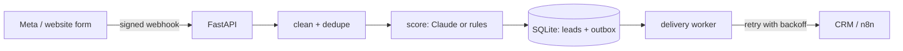

# lead-router

[](https://github.com/RutuK2005/lead-router/actions/workflows/ci.yml)  [](LICENSE)

A webhook service for incoming leads. It takes leads from Meta lead ads, website forms or any flat JSON, cleans them up, scores them, and forwards them to a CRM or an n8n workflow.

I do a lot of clinic lead automation in n8n, and the same problems keep coming up: duplicate leads, phone numbers in five different formats, junk submissions, and leads that silently disappear when the CRM webhook is down for a few minutes. This is my attempt at handling all of that properly in one small Python service.

## What it does

- Checks an HMAC signature (plus a timestamp, so old requests can't be replayed) on every incoming webhook
- Maps each source's payload into one `Lead` model
- Normalises phone numbers to E.164 (India by default), validates emails, fixes name casing
- Drops duplicates by phone/email within a 24h window
- Scores each lead as hot / warm / cold / spam with Claude, using structured output so the reply always matches a schema. With no API key, or if the call fails, it falls back to a simple rule-based scorer
- Saves the lead and its delivery jobs in one SQLite transaction (outbox pattern), and a background worker delivers them with retries and exponential backoff. Deliveries that keep failing end up as "dead" so they can be re-sent later



## Running it

Python 3.12+.

```bash
python -m venv .venv
source .venv/bin/activate          # Windows: .venv\Scripts\activate
pip install -e ".[dev]"
cp .env.example .env
```

Then in three terminals:

```bash
python scripts/mock_destination.py --port 9000 --fail-first 1   # fake CRM, fails once so you see a retry
uvicorn lead_router.main:create_app --factory --port 8000
python scripts/send_sample.py meta                              # also: website, generic
```

`curl localhost:8000/leads` shows what came in and where it went. `/metrics` has counts, and `/docs` has the full API. There's also a `docker-compose.yml`, which can start n8n next to the service. The workflow to import is in `n8n/lead-router-workflow.json`.

Settings are environment variables, listed in `.env.example`. The important ones are `WEBHOOK_SECRETS`, `DESTINATIONS` and `ANTHROPIC_API_KEY` (optional).

## Notes

- Delivery is at-least-once, so a lead can occasionally be sent twice. Every request carries an `Idempotency-Key` so the receiving side can ignore repeats.
- Scoring happens inside the webhook request, so with the LLM turned on the response waits for the model (20s timeout). Moving it into the worker would make responses faster.
- The worker runs inside the API process and assumes a single instance. Running more than one would need Postgres with row locking, or a proper queue.
- Real Meta webhooks only send a `leadgen_id`. The usual setup is an n8n flow that fetches the full lead from the Graph API and forwards it here.

## Tests

```bash
pytest
ruff check .
```

No network or API key needed; the Claude client and HTTP destinations are mocked.

## TODO

- Native Meta signature (`X-Hub-Signature-256`) and Graph API fetch
- Move scoring into the worker
- Per-CRM field mapping

All names and numbers in `samples/` are made up.
